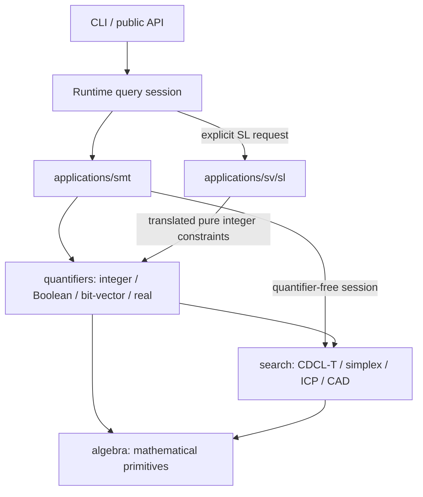

# Xolver

Xolver is an SMT solver for quantifier-free nonlinear arithmetic and its combinations with uninterpreted functions, arrays, and algebraic datatypes. Dedicated native algorithms handle quantified Boolean, fixed-width bit-vector, Presburger and polynomial real arithmetic formulas. Separation logic has an independent heap semantics and solver entry. A CaDiCaL-driven CDCL(T) core orchestrates theory solvers that reason over exact rational (GMP/MPFR) and real-algebraic (libpoly) arithmetic, with no floating point on the decision path. Incomplete reasoning yields `unknown` rather than an unsound verdict.

At SMT-COMP 2026, Xolver competed as a Standalone Solver and received two awards: **Single Query Track Largest Contribution — UNSAT Performance Winner** and **QF_NIRA Winner**.

---

## Supported logics

| Family                | Logics                                                                          |
| --------------------- | ------------------------------------------------------------------------------- |
| Boolean / EUF         | `QF_BOOL`, `QF_UF`                                                              |
| Linear real / integer | `QF_LRA`, `QF_LIA`, `QF_LIRA`                                                   |
| Difference logic      | `QF_IDL`, `QF_RDL`                                                              |
| Nonlinear             | `QF_NRA`, `QF_NIA`, `QF_NIRA`                                                   |
| UF + arithmetic       | `QF_UFLRA`, `QF_UFLIA`, `QF_UFNRA`, `QF_UFNIA`                                  |
| Arrays                | `QF_AX`, `QF_ALIA`, `QF_ALRA`, `QF_AUFLIA`, `QF_AUFLRA`, `QF_ANIA`, `QF_AUFNIA` |
| Datatypes             | `QF_DT`, `QF_UFDT`, `QF_UFDTNIA`                                                |

Quantified algorithms accept arbitrary binder alternation within their supported
signatures: Boolean formulas (QBF), fixed-width bit-vectors (QBV), Presburger
integer arithmetic (`LIA`), and polynomial real arithmetic (`LRA`, `NRA`).
Ground bit-vector formulas use the finite-domain backend. See the
[operator and resource boundaries](src/quantifiers/README.md).

---

## Architecture



The [architecture and call-flow diagrams](docs/ARCHITECTURE.md) describe application
selection, quantifier algorithms and reusable search infrastructure.
`applications/Solver.h` provides the abstract identity and typed `solve` interface.
Each application owns its input and result semantics; SMT and SV applications
are independent. CP, MILP optimization, counting, ODE and PDE are reserved
application interfaces with no solver implementation. OMT exposes an API but
has no objective-search algorithm.

SOMTParser's DAG is the shared formula representation. `NativeTerms` provides
handles, scopes, metadata and ground-term construction. Quantifier and SL
algorithms consume native nodes and build domain-specific representations.

Xolver uses [SOMTParser](https://github.com/fuqi-jia/SOMTParser) as its frontend for SMT-LIB parsing, type checking, expression management, and rewriting.

---

## Building

Requires CMake ≥ 3.16, a C++20 compiler, GMP, and MPFR. CaDiCaL and libpoly are git submodules; nlohmann/json and doctest are fetched at configure time.

```bash
git clone --recursive git@github.com:fuqi-jia/Xolver.git
cd Xolver && mkdir build && cd build
cmake ..                 # Release (-O3) by default
cmake --build . -j2      # on WSL / low-RAM, keep -j bounded
```

CLI at `build/bin/xolver`. CMake options: `XOLVER_BUILD_TESTS`, `XOLVER_BUILD_TOOLS`, `XOLVER_ENABLE_PROOFS`, `XOLVER_STATIC_BUILD`.

---

## Usage

```bash
./build/bin/xolver solve input.smt2                  # sat / unsat / unknown
./build/bin/xolver solve input.smt2 --produce-models # with model
./build/bin/xolver model-check input.smt2            # solve, then strictly check the model
./build/bin/xolver proof-check <proof>               # check a proof certificate
```

---

## Testing

```bash
cd build && ctest                          # unit + per-logic regression
./build/tests/xolver_unit_tests            # unit only
python3 tools/regression/run_regression.py --root tests/regression --solver build/bin/xolver
```

The regression harness compares stdout verdicts with the embedded `:status`;
it does not invoke z3/cvc5. Differential tools run those oracles separately.
Opposite verdicts and crashes always fail, including known-gap cases.

Algorithm tests exercise scope preservation, quantifier alternation, exact
arithmetic, models and resource exhaustion. Differential tools compare verdicts
with independent solvers. [Validation records](docs/README.md) identify the
source revisions, binaries, inputs and results of individual runs.

---

## Repository layout

| Path | Contents |
| --- | --- |
| `src/base/` | Exact values, resource budgets and typed process configuration |
| `src/ir/` | SOMTParser DAG handles, sorts and ground-term interfaces |
| `src/contracts/` | Theory-specific formulas, models and solver contracts |
| `src/algebra/` | Polynomial representation and exact algebraic operations |
| `src/evidence/` | Independent model checks and proof/certificate serialization |
| `src/applications/` | SMT, OMT, CP, MILP, DE, SV and counting application entries |
| `src/quantifiers/` | Quantifier algorithms above search and algebra |
| `src/frontend/` | Parser integration and ground preprocessing |
| `src/search/` | Reusable SAT, theory search, combination and numeric search engines |
| `src/runtime/` | Query lifecycle, dispatch and public API implementation |
| `include/xolver/`, `app/`, `python/` | Public headers, CLI and Python bindings |
| `tools/`, `tests/` | Validation, differential tests, server workflows and regression inputs |
| `third_party/` | SOMTParser, CaDiCaL and libpoly dependencies |

---

## License

Apache License 2.0 — see [`LICENSE`](LICENSE). Third-party dependency manifest in [`NOTICE`](NOTICE).

Xolver does not call, wrap, link, or include source from any existing SMT solver. Comments citing cvc5, z3, or others are algorithmic attribution for published algorithms (CDCAC, Lazard projection, Nelson–Oppen); the implementations are independently written.

Xolver is developed through a researcher-led workflow with AI assistance for
implementation, review and testing.

Candidate models can be checked against the original formula using exact
arithmetic. Model validation distinguishes satisfaction, violation and an
indeterminate result; `--certify` requires positive validation. UNSAT evidence
coverage is partial. A checked Boolean skeleton does not certify assumed theory
lemmas or preprocessing. See [proof tooling](tools/proof/README.md).

[Quantifier algorithms](src/quantifiers/README.md) support separate Boolean,
bit-vector, integer and real domains. Mixed quantified theories, uninterpreted
functions, arrays and transcendental arithmetic are outside these algorithms'
signatures. General quantified and inductive SL has incomplete coverage. Work,
memory and time limits can produce `unknown`; an unresolved search does not
establish unsatisfiability. End-to-end formal verification of the C++ solver is
not provided.

### Citation

```bibtex
@software{xolver,
  title  = {Xolver: an SMT solver for nonlinear arithmetic},
  author = {Fuqi Jia and contributors},
  year   = {2026},
  url    = {https://github.com/fuqi-jia/Xolver}
}
```
