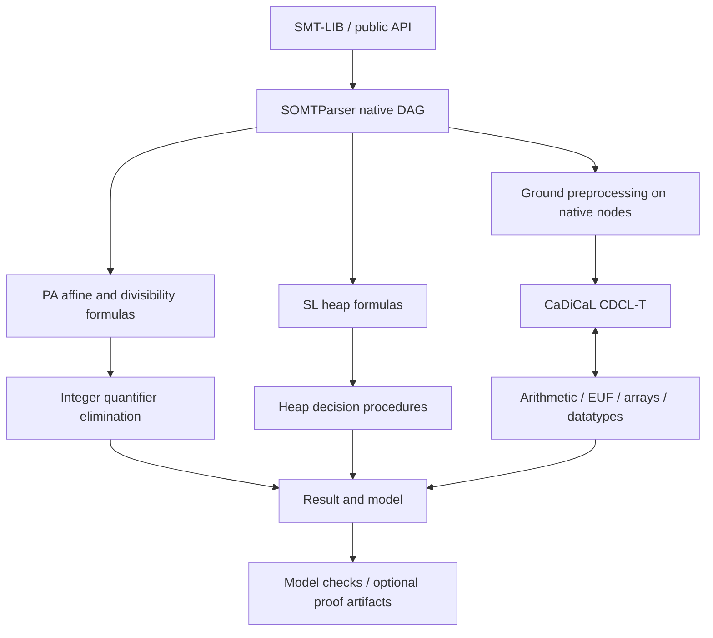

# Xolver

Xolver is an SMT solver for quantifier-free nonlinear arithmetic and its combinations with uninterpreted functions, arrays, and algebraic datatypes. Dedicated native paths also handle quantified Presburger arithmetic and quantifier-free separation logic. A CaDiCaL-driven CDCL(T) core orchestrates theory solvers that reason over exact rational (GMP/MPFR) and real-algebraic (libpoly) arithmetic, with no floating point on the decision path. Incomplete reasoning yields `unknown` rather than an unsound verdict.

At SMT-COMP 2026, Xolver competed as a Standalone Solver and received two awards: **Single Query Track Largest Contribution — UNSAT Performance Winner** and **QF_NIRA Winner**.

---

## Supported logics

| Family                | Logics                                                                          |
| --------------------- | ------------------------------------------------------------------------------- |
| Boolean / EUF         | `QF_BOOL`, `QF_UF`                                                              |
| Linear real / integer | `QF_LRA`, `QF_LIA`, `QF_LIRA`                                                   |
| Difference logic      | `QF_IDL`, `QF_RDL`                                                              |
| Nonlinear             | `QF_NRA`, `QF_NIA`, `QF_NIRA`                                                   |
| UF + arithmetic       | `QF_UFLRA`, `QF_UFLIA`, `QF_UFNRA`, `QF_UFNIA`                                  |
| Arrays                | `QF_AX`, `QF_ALIA`, `QF_ALRA`, `QF_AUFLIA`, `QF_AUFLRA`, `QF_ANIA`, `QF_AUFNIA` |
| Datatypes             | `QF_DT`, `QF_UFDT`, `QF_UFDTNIA`                                                |

---

## Architecture



There is one shared general formula representation: the SOMTParser DAG.
`NativeTerms` supplies handles, scopes and metadata; its temporary `Kind`/`TermExpr`
read/construction interfaces still serve legacy ground consumers. PA and SL
consume native nodes directly and build their own theory representations.
The old CoreIR graph is removed; compatibility-interface cleanup remains in scope.


Xolver uses [SOMTParser](https://github.com/fuqi-jia/SOMTParser) as its frontend for SMT-LIB parsing, type checking, expression management, and rewriting.

---

## Building

Requires CMake ≥ 3.16, a C++20 compiler, GMP, and MPFR. CaDiCaL and libpoly are git submodules; nlohmann/json and doctest are fetched at configure time.

```bash
git clone --recursive git@github.com:fuqi-jia/Xolver.git
cd Xolver && mkdir build && cd build
cmake ..                 # Release (-O3) by default
cmake --build . -j2      # on WSL / low-RAM, keep -j bounded
```

CLI at `build/bin/xolver`. CMake options: `XOLVER_BUILD_TESTS`, `XOLVER_BUILD_TOOLS`, `XOLVER_ENABLE_PROOFS`, `XOLVER_STATIC_BUILD`.

---

## Usage

```bash
./build/bin/xolver solve input.smt2                  # sat / unsat / unknown
./build/bin/xolver solve input.smt2 --produce-models # with model
./build/bin/xolver model-check input.smt2            # solve, then strictly check the model
./build/bin/xolver proof-check <proof>               # check a proof certificate
```

---

## Testing

```bash
cd build && ctest                          # unit + per-logic regression
./build/tests/xolver_unit_tests            # unit only
python3 tools/regression/run_regression.py --root tests/regression --solver build/bin/xolver
```

The regression harness compares stdout verdicts with the embedded `:status`;
it does not invoke z3/cvc5. Differential tools run those oracles separately.
Opposite verdicts and crashes always fail, including known-gap cases.

The [gate cleanup audit](docs/audit/GATE-CLOSEOUT.md) records the current source
and validation status. The latest broad server run has one unresolved NRA
model-check timeout; full PA/SL completion remains separate work.

---

## Repository layout

| Path | Contents |
| --- | --- |
| `src/base/` | Exact values, resource budgets and typed process configuration |
| `src/ir/` | SOMTParser DAG handles, sorts and temporary compatibility interfaces |
| `src/contracts/` | Theory-specific formulas, models and solver contracts |
| `src/algebra/` | Polynomial representation and exact algebraic operations |
| `src/evidence/` | Independent model checks and proof/certificate serialization |
| `src/decision/` | Native PA and SL decision procedures |
| `src/frontend/` | Parser integration and ground preprocessing |
| `src/search/` | SAT, theory search, combination and heuristics |
| `src/runtime/` | Query lifecycle, dispatch and public API implementation |
| `include/xolver/`, `app/`, `python/` | Public headers, CLI and Python bindings |
| `tools/`, `tests/` | Validation, differential tests, server workflows and regression inputs |
| `third_party/` | SOMTParser, CaDiCaL and libpoly dependencies |

---

## License

Apache License 2.0 — see [`LICENSE`](LICENSE). Third-party dependency manifest in [`NOTICE`](NOTICE).

Xolver does not call, wrap, link, or include source from any existing SMT solver. Comments citing cvc5, z3, or others are algorithmic attribution for published algorithms (CDCAC, Lazard projection, Nelson–Oppen); the implementations are independently written.

Xolver was developed through a **researcher-led, AI coding-agent-assisted workflow**. The author defined the overall solver architecture, algorithm design and selection, task decomposition, integration, testing, and validation. AI coding agents (Claude Opus 4.7 / Sonnet 4.6, ChatGPT 5.5, Kimi 2.6) carried out much of the code implementation under this coordination, with role-specialised agents for individual theory lanes (LRA/LIA, NRA, NIA, EUF/arrays, combination, and infrastructure).

Candidate models can be checked against the original formula using exact
arithmetic. Validation is three-valued: a model may satisfy, violate, or be
indeterminate. Legacy solving paths do not all require positive validation;
`--certify` requires it. UNSAT proof coverage is partial, and a checked Boolean
skeleton does not certify assumed theory lemmas or preprocessing.

The [verification architecture audit](docs/audit/ARCHITECTURE.md) records the
remaining work, runtime-control inventory, fixes, and preparation for Presburger
arithmetic and separation logic. The [current native-DAG implementation](docs/audit/NATIVE-TERMS.md)
uses SOMTParser nodes directly and reconstructs free-variable models for its
budgeted quantified PA procedure. [Independent PA replay](docs/audit/PA-ISABELLE.md)
checks selected original claims in Isabelle.
The [Boolean separation-logic core](docs/audit/SEPARATION-BOOLEAN.md) adds nested
negation, star and wand, typed heap records and a standalone concrete-heap
checker to the earlier symbolic-heap API. Direct native SL parser/runtime
integration combines linear integer terms, constant div/mod and ite/abs with
Boolean connectives, star and wand over integer addresses/data. It exports
checked heap models and evaluates arithmetic `get-value` against the existing
model. [R33 server validation](docs/audit/VALIDATION-NATIVE-TERMS.md) records the
full test suites, arithmetic differential checks, semantic replays and a
reproduced unconstrained-nil inconsistency in the installed cvc5 oracle.
PA certificate coverage, further theory combinations, quantified and inductive
SL, and remaining unknown/performance cases are solver work still in progress.
The current task targets SMT solving and validation; a formal refinement proof
of the C++ implementation is not a delivery requirement.

### Citation

```bibtex
@software{xolver,
  title  = {Xolver: an SMT solver for nonlinear arithmetic},
  author = {Fuqi Jia and contributors},
  year   = {2026},
  url    = {https://github.com/fuqi-jia/Xolver}
}
```
