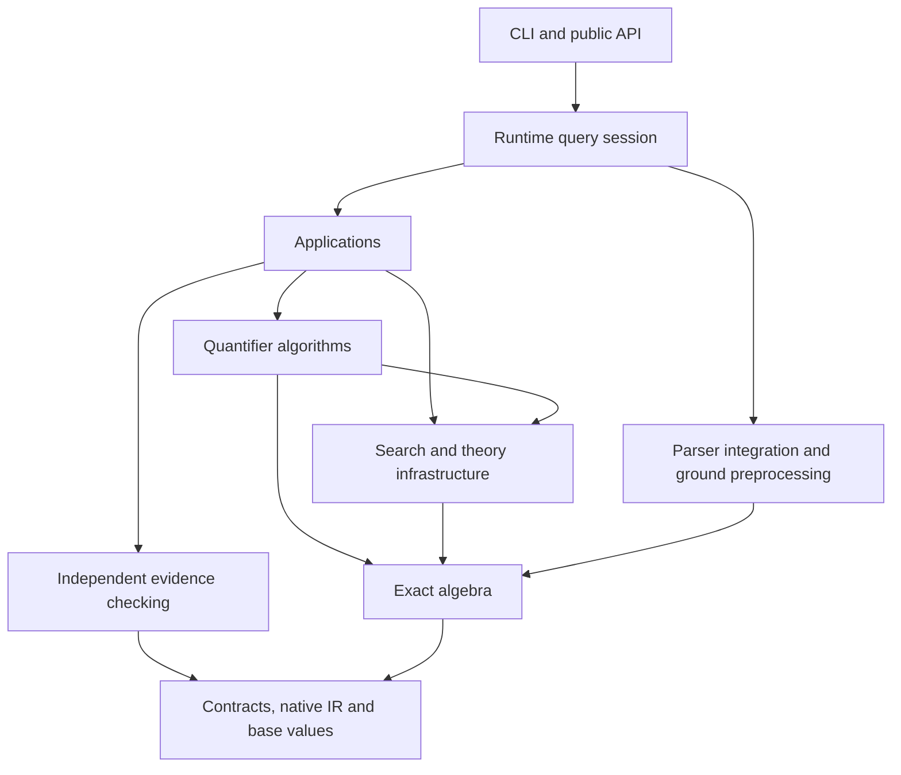
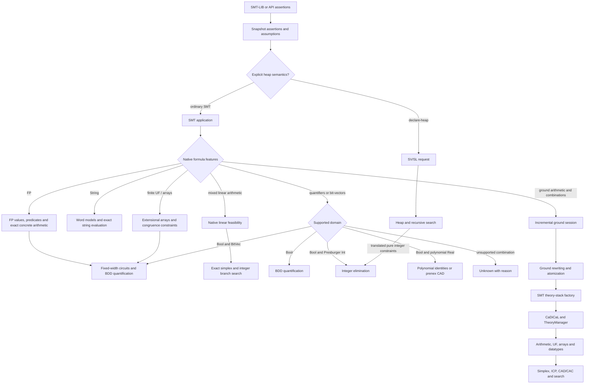
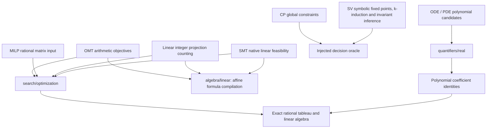

# Architecture

Xolver separates application semantics, quantifier algorithms, reusable search,
and exact mathematics. SOMTParser's DAG is the shared input representation.
Domain algorithms construct their own affine, polynomial, circuit or heap data.

## Dependencies

Arrows mean “may use”. `tools/governance/architecture.py` checks includes and
source ownership at configuration time and in CI.

`quantifiers` may use `search` and `algebra`. Lower layers cannot depend on
quantifier algorithms or application headers. Applications cannot depend on
other application families; SV/SL and SV/PA are also independent.

| Component | Owner |
| --- | --- |
| Abstract application identity and typed `solve` | `applications/Solver.h` |
| SMT input classification and theory composition | `applications/smt` |
| Shared SMT integer reasoning | `applications/smt/common/lia` |
| SMT mixed linear feasibility | `applications/smt/qflira` |
| Heap search, recursive semantics and pure-constraint translation | `applications/sv/sl` |
| Transition frames, exact successor images, invariant inference and safety certificates | `applications/sv/verification` |
| Native binder compilation and domain-specific elimination | `quantifiers` |
| CRT, integer witnesses and polynomial operations | `algebra` |
| SAT, simplex, ICP, root isolation and reusable search | `search` |
| Rational objective optimization and mixed-integer branch search | `search/optimization` |
| Native affine formula compilation and exact linear systems | `algebra/linear` |

A helper belongs to its sole consumer. Helpers shared within an application
belong to that application's `common/`. Cross-application algorithms belong to
the appropriate lower layer with explicit, application-independent contracts.

`TypedSolver<Input, Output>` supplies a virtual `solve(const Input&)`.
Application outputs have distinct semantics: a satisfiability result, optimum,
count or differential-equation solution cannot share an untyped result contract.
`TheorySolver` is the CDCL(T) callback interface in the infrastructure layer.

## Query flow

Binder detection precedes ground rewriting and atomization. The ground factory
rejects quantified inputs. A non-QF logic declaration does not permit binders to
cross that boundary. Integer certificate requests explicitly select the integer
algorithm and are rejected for unrelated domains.

The real algorithm uses full coefficient and principal-subresultant projection
of iterated reducta, followed by exact section/sector lifting in quantifier order.
Finite-domain algorithms preserve fixed-width arithmetic. Integer elimination
uses affine constraints and divisibility. See [quantifier algorithms](../src/quantifiers/README.md)
for operator signatures and resource limits.

`declare-heap` selects SL semantics; arrays named `heap` and variables named
`pointer` do not. SHID-family selection supplies least-fixed-point recursive
semantics. Ordinary recursive SMT equations do not imply inductive SL semantics.
The SL algorithm passes its translated pure constraints directly to integer
quantifier infrastructure. The independent PA API also uses that infrastructure.

Runtime owns push/pop scopes, assumptions, result lifetimes, models and proof
export. Its stateful ground session is passed into the SMT application as a
callback. Quantifier solving runs over the current native assertion snapshot.

## Application composition

Objective optimization uses a two-phase rational primal simplex. Incremental
CDCL(T) feasibility retains its bound-based simplex and SAT conflict reasons;
these are distinct algorithm contracts. CP and verification compile requests for
an injected oracle, without a dependency on another application family. DE and
SV share identity-based native substitution in `ir/NativeSubstitution.h`.

State verification accepts explicit initial/transition/safety formulas, immutable
parameters and fresh inputs per transition. Only checked inductive candidates
strengthen safety proofs. The SL application owns heap entailments and
least-fixed-point predicate induction; it uses the integer quantifier algorithms
directly for pure arithmetic. Neither application delegates arbitrary formulas
to the PA application. See [SV call flow and contracts](../src/applications/sv/README.md).

Exact image construction and invariant/certificate checking share verification's
private transition helper. SL's induction, invariant and unfolding procedures
share definition expansion and capture avoidance in `sl/InductiveExpansion`.
Predicate relation proofs use simultaneous least-fixed-point induction and
structural heap rules. Every supplied certificate lemma is rechecked; candidate
inference may discard open lemmas, certificate validation cannot.

## Capability and evidence boundaries

SMT, OMT, CP, MILP, counting, verification conditions, PA, SL, ODE and PDE have
typed application entries and executable backends. Their general contracts and
backend limits are documented in [applications](../src/applications/README.md). Experimental MCSAT/NLSAT components are
available as source but are not the default query path.

Quantified UF, arrays, mixed integer/real and mixed integer/bit-vector formulas
require algorithms outside the implemented domain signatures. General quantified
and recursive SL remains incomplete. Resource exhaustion and unsupported inputs
produce `unknown` with a reason.

Native models and elimination traces are distinct from independently checked
proofs. Boolean/BV and real quantifier algorithms do not export end-to-end UNSAT
certificates. Proof tooling distinguishes complete emitted problems, Boolean
skeletons and absent evidence; see [proof tooling](../tools/proof/README.md).

[Validation records](README.md) preserve the exact source, inputs and binary
provenance of each run. They do not redefine the current architecture.
