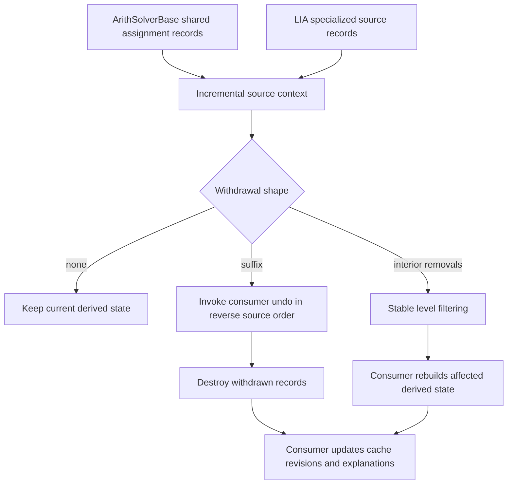

# Incremental source contexts

`base/IncrementalContext.h` provides `incremental::Context<Entry, LevelOf>`.
It owns level-tagged records and exposes read-only entries. A stateless level
projection defaults to `entry.level`. The module has no SAT, formula, arithmetic,
model or proof dependencies.

The API consists of `append`, indexed `replace`, `backtrack`, `clear`, and owning
`snapshot`/`restore`. Derived caches remain with their consumers. The result of
`backtrack` identifies unchanged, suffix and filtered withdrawals, the first
changed index and the number of removed entries.

For ordered levels, withdrawal finds the suffix by binary search, then performs
O(removed entries) destruction and callbacks. Parent records are neither copied
nor moved. Source replacement can invalidate level ordering. The context then
checks the actual withdrawal shape and uses stable filtering if necessary;
surviving records retain their order.

An undo callback reads an entry before its destruction. It must not throw or
reenter the context. Interior filtering does not call suffix undo. A consumer
whose cache order differs from source order can skip undo and rebuild after
either kind of withdrawal. Source keys, reference counts, cache revisions,
integrality choices and proof dependencies are consumer responsibilities.

LIA uses suffix callbacks for its atom/disequality caches, variable-use counts
and SAT-variable index. It relinks retained integer-variable membership in its
original insertion order. A replaced source invalidates the cache-order
invariant, so LIA rebuilds those caches after withdrawal. Its simplex bound base
and immutable explanation snapshots are managed separately. ArithSolverBase
uses the same context for the assignment records consumed by IDL, RDL, LIRA,
NIA and NIRA; NIA appends through the context in its custom admission path.

Snapshots own their records and support restoration after replacement,
withdrawal and reset. Taking one is explicitly O(number of records); restoring
a moved snapshot swaps its storage. Ordinary decision backtracking takes no
snapshot. LIA's application scopes save this snapshot alongside interface
equalities, disequalities and the current level. Each theory retains its own
scope policy: `backtrack(0)` keeps level-zero records, whereas a SAT restart
that requires complete reassertion explicitly calls `clear()`.

Tests compare 1,000 generated append/replace/backtrack/snapshot compositions
against independent level filtering. They also check reverse undo order,
move-only parent storage, custom level projections, root retention, invalid
replacement indices, LIA source/cache transitions and shared arithmetic hooks.
