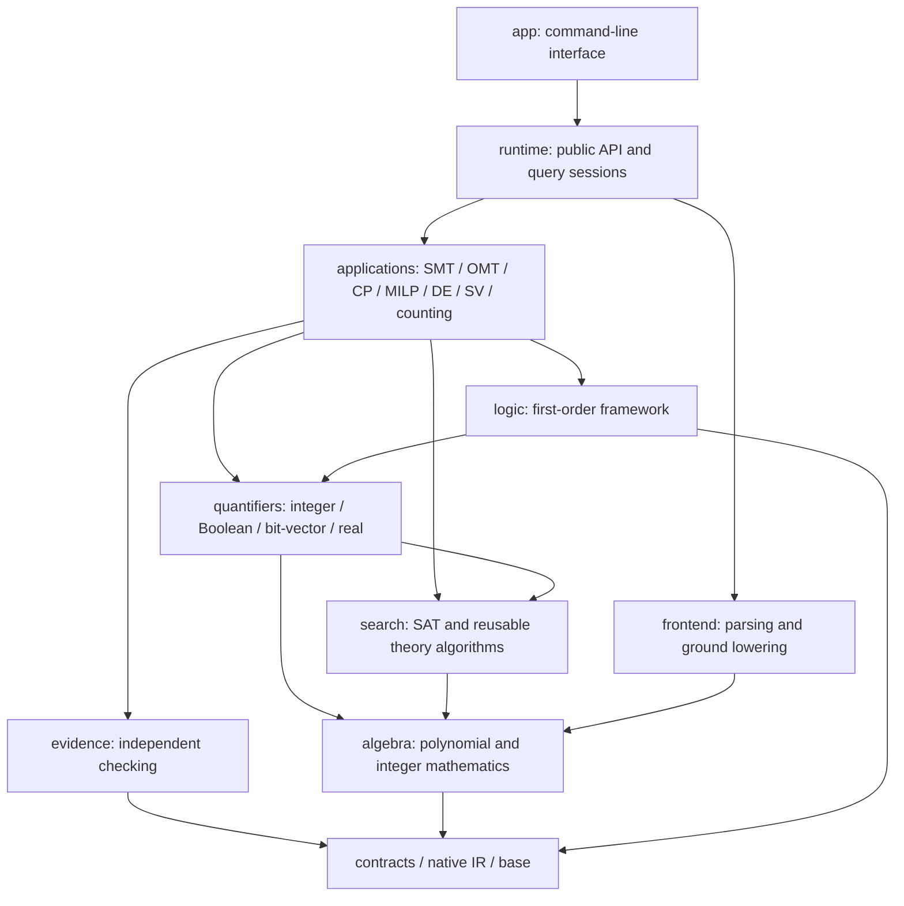
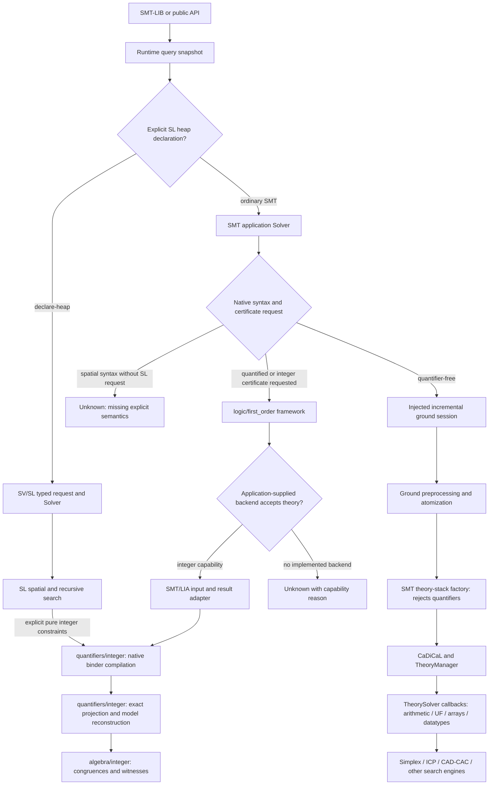
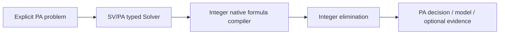

# Application architecture migration record

This is a revision-specific migration record. For the checked-out version, see
[current architecture and query flow](../ARCHITECTURE.md).

This migration starts from `d173712fd3e0502499729183e50d6136a336d990`.
It reorganizes existing implementations and establishes independent application
interfaces. It does not claim new general first-order or optimization algorithms.

## Source dependency direction

An arrow means “may include/use”. The checker validates actual includes at CMake
configuration and in tests. Runtime callbacks do not reverse these source edges.

`quantifiers` can use `algebra` and `search`; the reverse direction is forbidden.
Integer elimination belongs to `quantifiers/integer`, not to the PA application
or to the algebra layer. Numeric congruence and witness operations remain in
`algebra/integer`. No foundation includes an application header.

Applications cannot include other application families. SV/SL cannot include
SV/PA either. Shared code stays at the nearest appropriate owner:

| Component | Owner | Reason |
| --- | --- | --- |
| Abstract application identity and typed `solve` | `applications/Solver.h` | Used by all application entries |
| LIA CDCL(T) component | `applications/smt/common/lia` | Used by QF LIA, SMT combinations and NIA linear subproblems |
| NIA linear-subproblem orchestration | `applications/smt/qfnia` | Only the NIA application component uses it |
| Existing MILP feasibility engine | `applications/smt/qflira` | One current consumer; it has no optimization objective |
| SL heap search, recursive semantics and integer bridge | `applications/sv/sl` | Specific to SL |
| Native integer binder compilation and elimination | `quantifiers/integer` | Shared logical/mathematical capability, with no application selection |
| CRT and integer witness calculations | `algebra/integer` | Mathematical primitive without native syntax |

The abstract root has virtual identity/lifetime operations. Its
`TypedSolver<Input, Output>` specializations provide virtual `solve`; this avoids
type-erased inputs and preserves each application's result semantics. C++ virtual
function templates are not possible. SAT/theory callback interfaces remain lower
contracts and do not inherit an application interface.

## Actual query calls

The application supplies a backend implementing the first-order framework's
interface. The framework does not know about PA or SL applications. The integer
backend checks its supported arithmetic grammar; it is not a fallback for real,
UF, array, bit-vector or spatial formulas. A QF stack cannot be constructed from
a profile containing quantifiers, including when a non-QF logic name is used.

`declare-heap` explicitly selects SL input semantics. An SMT array named `heap`,
a pointer variable or a memory encoding does not. Ordinary recursive SMT equations
do not acquire least-fixed-point SL semantics: the existing explicit SHID-family
selection is preserved. SL sends only the pure integer constraints produced by
its own translation to integer quantifier algorithms, never to the PA application.

The public API still owns scopes, assumptions and result lifetime. The existing
stateful ground pipeline remains in `runtime::Solver::Impl::checkSatGround` and is
injected into the SMT application. The diagrams show that bridge explicitly;
the monolithic ground-session state has not been completely decomposed by this
migration. The migrated logic components and factory are in `applications/smt`.

The independent PA API follows its own flow:

## Capability boundary

Existing QF logic implementations, native PA and SL algorithms, and experimental
MCSAT/NLSAT code are retained. The existing OMT skeleton implements the typed
application interface but still has no objective-search algorithm. CP, MILP
optimization, counting, ODE and PDE directories document future applications.
QBF, QBV and quantified real algorithms have dedicated quantifier locations and
are not implemented by creating those directories. General first-order
instantiation/MBQI and a complete theory portfolio remain future work.

Tests cover cross-application and upward dependency rejection, parser-independent
arithmetic, the abstract application interface, independent first-order backends,
explicit SL semantics and rejection of quantifiers by the QF factory. Server
build and behavioral validation are recorded separately; source layering alone
is not evidence of semantic equivalence or performance improvement.

## Validation record

See [APPLICATION-VALIDATION.json](APPLICATION-VALIDATION.json) for exact server
experiments, binaries and retained failures. The pre-repair migration run built all targets,
passed 833 selected existing tests and all six new application-dispatch tests,
and had no wrong answers or verdict regressions in 902 paired cases. That pre-repair
selection failed broader acceptance: it retained three native baseline failures
and six PA parser errors. Those historical records do not claim full-suite success.

Subsequent CI repairs resolved those failures. The final 1507-unit / 850-regression /
115-PA server validation and proof coverage limits are tracked in
[CI-REPAIR.md](CI-REPAIR.md).
