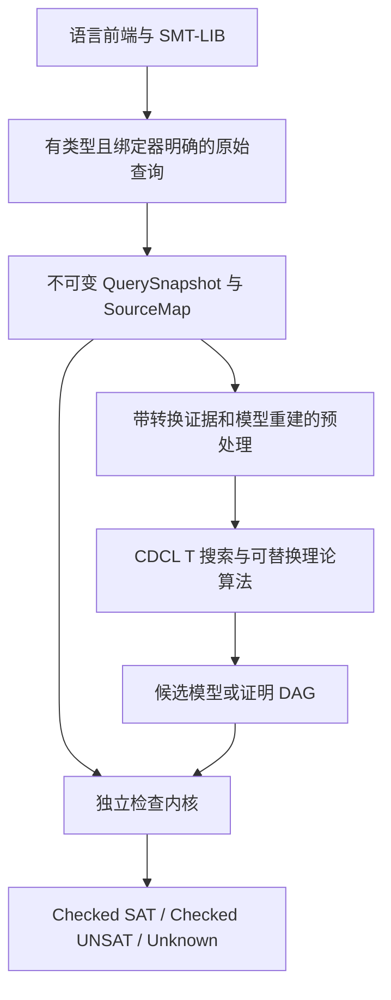

# 面向程序验证的 Xolver 审计与演进方案

审计基线：`e927757f5a033e244e96d7d41234866fb783d038`。本文件描述代码证据、已实施修复和后续设计，不能作为“全仓库无 bug”或“形式化验证已完成”的声明。服务器验证结果另见 [VALIDATION.md](VALIDATION.md)。

当前物理分层及原生 SOMTParser IR 的迁移决定见 [RESTRUCTURING.md](RESTRUCTURING.md)。以下保留分轮审计背景，旧路径以 `architecture-migration.json` 为迁移索引。

本文件保留第一轮问题分析与长期设计。第二轮已落地的配置迁移、PA 决策后端、符号堆求解与 Coq 规则证明详见 [IMPLEMENTATION.md](IMPLEMENTATION.md)，以下未实现状态按第二轮进展更新。

## 1. 结论

适合继续使用现有 CaDiCaL/CDCL(T)、精确算术和理论插件进行高效搜索；应该重构的是**查询状态、配置、证据和语义边界**。建议采用“可替换的搜索器 + 小型独立证书检查内核”。搜索算法可以复杂、启发式和不完备，结论的证据必须明确，资源耗尽不能成为 UNSAT 理由。

现有代码还不满足“默认所有 SAT/UNSAT 均已独立证实”的要求。README 的模型验证描述比实际实现强：部分路径只检查 `Violated`，`Indeterminate` 仍然可以返回 SAT；证明工具还存在可信预处理和不完整证书覆盖。`QF_LIA` 支持也不能等同于完整的、有量词的 Presburger arithmetic。第二轮已将有量词整数公式在 ground 预处理前路由到独立 PA 决策后端，并实现有限符号堆 API。完整 PA 证据/模型重建、SL 的 SMT-LIB 前端、归纳谓词和蕴含仍待实现。

长期目标覆盖数学算法、C/C++ 和 Java/托管程序。三者共享求解和证据协议，采用独立的语言语义配置，不根据变量名或逻辑字符串猜测语义。

## 2. 当前结构与主要问题

| 层 | 可复用部分 | 需要处理的问题 |
|---|---|---|
| SOMTParser → CoreIr | 独立前端、DAG、精确数值载荷 | 原始断言已经过导入重写；证明到原始文本的对应关系尚不完整；有量词时还需要显式绑定器与捕获规避 |
| 预处理 | div/mod、ITE、cast、替换及模型重建 | 对活动断言原地改写；原实现可能把降解后的状态带到下一次查询；存在片段特例和命名约定 |
| SAT / theory core | CaDiCaL、理论回溯、lemma registry | 理论冲突、传播和跨理论共享等式均需要可检查的理由；不能跳过已被 EUF 合并的跨理论义务 |
| 算术 | GMP/MPFR/libpoly、LIA/simplex、整数约束 | 非线性搜索与 PA 决策应分开；有限枚举只在有完整域证据时允许支持 UNSAT |
| EUF / 数组 / DT | e-graph、数组公理、数据类型插件 | 仍存在不能提取完整模型的情况；有限 sort 不满足普通 Nelson–Oppen 的稳定无限性条件 |
| 验证 / 证明 | ArithModelValidator、Alethe、DRAT/LRAT 工具 | “未发现违反”与“确定满足”混用；检查 CNF 骨架不能证明被当作公理的理论 lemma |
| 公共 API / Python | 增量接口、propagator、Python DSL | 原实现句柄空值不一致、无上下文身份；跨实例或 reset 后句柄可能静默引用不同节点；部分 sort 仍是未实现接口 |
| 配置 / 调优 | 数值预算和可复现实验 | 数百个环境控制项、静态缓存、presence/非零语义混杂；CLI 与库默认配置不同；portfolio 修改进程全局环境 |
| 测试 / 部署 | 单测、按逻辑回归、差分和 proof tooling | 原回归器可掩盖错误结论、崩溃；已知缺口原先不参加 CTest；proof 构建默认关闭 |

完整、可重新生成的当前运行时控制项清单在 [FLAGS.md](FLAGS.md) 和 [FLAGS.json](FLAGS.json)。分类是审计线索，不能把 `diag()` 读取自动认定为“只影响日志”。

## 3. 本次已实施的基础修复

| 问题 | 修改 | 对应验证 |
|---|---|---|
| 公共 Term/Sort 将 0 视为空，而 IR 使用 UINT32_MAX | 统一空值；加入上下文身份；拒绝跨实例及 reset 后句柄 | `query contract` 单测 |
| OptionValue 默认状态未初始化；字符串字面量会优先转换为 bool | 初始化 union/type；加入 `const char*` 重载 | 同上 |
| 空 Solver 上 push 不创建作用域 | push 建立 IR；pop 越界明确报错 | 同上 |
| 预处理把改写后的断言留给下次求解 | 逐查询保存并以 RAII 恢复原有断言及各自 scope | 重复求解、solve-eqs、push/pop 单测 |
| assumptions 只在后端原子化，绕过预处理、特征检测及部分模型搜索 | 将 assumption 的受保护定义纳入整个管线；模型检查包含原 assumption；保留 SAT assumption core | assumption 算术/非线性单测 |
| 旧模型、core、证明及预处理缓存跨查询泄漏 | 清理结果生命周期；parse 成功后事务式替换上下文；失败保留原上下文 | 状态机单测 |
| portfolio 线程遇到异常时可能在 joinable thread 析构中 terminate；环境恢复不保证 | 使用 jthread 和停止令牌；第二轮改为每策略臂私有配置快照 | 服务器回归及代码检查 |
| portfolio 预算使用 `atoi/atol`，溢出可变成错误预算；计划与环境读取混杂 | `PortfolioConfig` 在查询入口读取一次；纯 `selectPortfolio` 只接收类型化配置；拒绝负预算并测试快照隔离 | portfolio 参数边界与纯计划测试 |
| 所有 Solver 共用一个 wall clock | 改为线程局部时钟；watchdog 使用显式终止接口 | 线程隔离单测 |
| 用 siglongjmp 跨越 C++ 非平凡对象恢复信号崩溃 | 移除外层 Solver 的该路径及强制崩溃开关；libpoly backend 内仍有同类信号恢复，尚待替换 | 源码清单、服务器回归 |
| 参数解析接受溢出、尾随垃圾、NaN/Inf | 检查 errno、完整消费、类型范围及有限值 | 参数对抗单测 |
| Boolean validator 缺少 ITE/XOR，并把不支持项当成 true | 内部使用三值逻辑；只有确定为 true 才通过 | 真值表、unsupported/双重否定单测 |
| `--certify` 把 Indeterminate 当作通过 | 提供 `validateModel()` 三值 API；证书必须得到 Satisfied | API 及 CLI 对抗检查 |
| proof-check 使用不安全的 shell 参数拼接，且误称有理论公理的骨架为完整证明 | 严格引用参数；CNF 声明含理论公理或缺少来源标识时不报告完整验证 | CLI 对抗检查 |
| EUF 冲突包含无 IR 来源的合成原子，证明重建越界崩溃 | 生成端与消费端都检查原子范围；无法定位时拒绝整份证书，禁止删掉单个前提 | 4 个真实崩溃样例及 46 例 proof corpus |
| checker 的 CR 行前缀被误判失败；CaDiCaL 的 DIMACS 日志污染 SMT-LIB stdout | 接受合法行首空白但拒绝伪成功标记；证明导出关闭底层文件日志 | checker 对抗测试、CLI 精确输出测试 |
| 回归脚本从 stderr 抽取结论；正确 token 后崩溃仍可能通过；known-unsound 可免除反向结论 | 只读 stdout；崩溃明确失败；反向结论始终硬失败；修正 manifest 段落解析及注释中的 status | `tests/tools/test_regression_harness.py` |
| 已知缺口不参与 CI | CTest `known-gaps` 允许 unknown，但错误答案、崩溃和超时失败 | CTest |
| tests=ON、tools=OFF 配置引用不存在的 CLI target | 只在 CLI 启用时注册依赖它的测试 | CMake 配置检查 |
| NIA eager SAT 搜索只看到 guarded assumptions，没有激活 indicator | 将查询和 core 的所有激活 indicator 一并传入候选搜索 | 非线性 assumption 单测 |
| 多查询脚本重复求解最终上下文；上游 check-sat-assuming 括号消费错误 | 词法扫描生成独立查询快照；假设只进入该查询；CLI 按源顺序执行 | query snapshot 单测、CLI 多查询和 get-value 测试 |
| 整数 API 限于 int64；Python 浮点被 limit_denominator 改值 | 任意精度整数字符串入口；浮点按其精确二进制值转有理数 | 大整数、精确字面量测试 |
| 用户以 `__` 开头的变量被当成辅助节点跳过特征检测 | 显式标记 routing auxiliary，取消名称猜测 | 保留前缀用户变量测试 |
| watchdog 加载后端裸指针与后端析构竞争 | 锁覆盖指针发布、终止调用和撤销；回调异常安全释放 CaDiCaL | 异常恢复及 portfolio 测试 |
| release 脚本删 build，路径不对应真实 target | 持久构建、串行锁；打包缺失工具立即失败 | 脚本检查与服务器构建 |
| 新 GCC/CMake 无法构建锁定依赖 | 集成层提供缺少的标准头和旧 libpoly 的 CMake policy floor，不改子模块修订 | 服务器构建 |

这些修改需要服务器结果支持，不能仅凭本表声称测试通过。详见验证记录。

`Term` 和 `Sort` 增加上下文身份后，C++ 对象布局发生变化；使用旧库的应用和 Python 扩展需要重新编译。参数规划已经有纯函数边界，但算法开关仍通过 `StrategyConfig::envFlags` 适配旧引擎；第二轮已统一核心配置读取、删除核心环境写入及 212 处函数静态参数缓存；参数语义的类型化归并和其他全局可变状态仍未全部消除，不能据此承诺多个 Solver 的完整并发隔离。

## 4. gate 的清理原则与本次实际删除

不能把语义前提、证明条件、资源预算、诊断开关和实验残留当成一种东西。比如有理数 simplex 的模型必须满足整数性才能得到 LIA 的 SAT；有限数据类型不能直接套用稳定无限理论组合。删除这些检查会改变数学语义。

本次删除的运行时入口：

- `XOLVER_COMB_SKIP_EUF_MERGED_UNSAFE`：其原注释明确记载 8 个 UNSAT → SAT 错误。实现保留了必要的跨理论等式传播，不再允许跳过。
- `XOLVER_NIA_FARKAS_OR_UNSAT_EMIT_UNSAFE`：不再允许绕过 outer assertions 前提。
- `XOLVER_DT_VALIDATE_OFF`：数据类型候选模型检查不再可关闭。
- `XOLVER_AX_NO_SELECT_COMPLETE`、`XOLVER_AX_NO_EXT_WITNESS_COMPLETE`：必要的数组完成义务不再有关闭入口。
- `XOLVER_SIGNAL_FIREWALL`、`XOLVER_TEST_FORCE_CRASH`：移除不安全的信号恢复路径及测试注入。
- `XOLVER_STRAT_PORTFOLIO_TEST_ARMS`：删除运行时复制策略臂的测试开关。原测试遇到第一个确定答案便退出，实际没有验证所谓“多个臂重入”；现测试明确区分纯计划、配置快照、首个确定答案和预算终止。

旧源码和历史结果仍由原 Git 修订保留，未删除历史研究资料或修改历史实验来源。旧 census 中的 pro/open 边界和“待合并分支”假设已从清单生成器移除；策略选择器中的空逻辑分支和已过时的合并计划也已删除，保持现有默认算法。

第一轮清单识别 406 个命名控制项、532 个字面量读取点，其中 20 项使用混合读取语义；第二轮当前精确数量以重新生成的 FLAGS.json 为准。此前 405 项清单未识别两个通过动态参数名读取的 LIA 预算；本次改成显式读取后，这两项首次进入清单，同时移除了一个测试开关。因此数量变化不能直接作为清理进度。动态读取点仍单独列出，清单不是静态分析完备性证明。

**第二轮完成了统一查询快照读取；开关语义尚未全部归并。** 后续仍应为每一项建立明确归宿：

| 当前形式 | 目标 |
|---|---|
| 正确性检查的 OFF/UNSAFE 开关 | 删除关闭入口；检查失败返回结构化 unknown 或拒绝证据 |
| 选择完整算法/后端 | 每实例 `SolverConfig` 中的枚举和能力描述 |
| 优化、预处理和证明规则选择 | 纯函数生成 `SolvePlan`，附适用片段与转换证据 |
| 时间、节点、位宽、次数 | 类型化 `ResourceBudget`，显式 exhaustion；不伪装成逻辑结论 |
| 诊断/采样 | 独立 `DiagnosticsConfig`；不得影响逻辑判断 |
| 已失效的 ablation / 发布分支遗留 | 删除活代码，来源留在 Git 和本次迁移说明 |

不能靠一个总开关把几百个旧开关藏起来。验收要求是搜索路径的环境读取收敛为一次配置解析，热路径不再读取 getenv，不再用 static 缓存把首个 Solver 的选择传播到其他实例。

## 5. 建议框架与可验证边界

需要分开四种状态：候选答案、内部校验通过、独立外部检查通过、证明助手核验通过。证书存在不表示证书已被检查，DRAT 骨架有效不表示理论 lemma 或预处理有效。

最终 `CheckedSat` 必须对原始查询和 assumptions 的完整模型检查成功；`CheckedUnsat` 必须追溯到原始前提，并逐项检查归一化、整数规则、理论 lemma 和命题反证。任何未支持项或缺失证据返回 unknown，保留具体 component/reason。旧 API 的 `Result::Sat/Unsat` 在迁移完成前应与这种较强的类型明确区分。

优先形式化证明小内核的规则健全性和变换的语义保持，不以形式化整个启发式 C++ 搜索器为先决条件。Isabelle AFP 已有可执行且形式化验证的 Presburger 消量词算法，可作为参考或未来经明确集成的独立检查后端，而不是仅引用论文便宣称本实现得到验证。[AFP LinearQuantifierElim](https://isa-afp.org/entries/LinearQuantifierElim.html)

目前的 Alethe 可继续用于跨工具证据交换；证明助手重建与外部 checker 是不同的信任层次。Alethe 的设计覆盖 SMT 证明规则和预处理，但具体规则是否被本项目生成、检查，需要逐条记录。[Alethe 原始论文](https://www.verit-solver.org/papers/pxtp2021.pdf)

## 6. Presburger arithmetic 的实施顺序

1. **PA 的规范 IR。** 任意精度整数系数、仿射项、等式/严格与非严格不等式、正模数同余、布尔组合和显式量词绑定。变量乘变量应明确拒绝为非 PA；乘常数和非零常数 div/mod 可归约为 PA。先把自由变量与绑定变量身份从名字中分离。
2. **可证 QF 路线。** 复用 simplex 求有理松弛模型；整数解精确检查；gcd/除尽性、取整切平面、branch-and-bound 每步携带证据。任何有界搜索都必须说明其域覆盖，找不到模型不能推出无界 UNSAT。
3. **完整 PA 路线。** 先实现可审计的 Cooper 型量词消去作为完整后备，逐变量导出等价变换；再按证据改善分块、共享和惰性消去。使用结构化预算控制膨胀，耗尽只返回 unknown。存在量词的 SAT 见证不能替代全称量词的决策证明。
4. **与验证需求连接。** 单独提供满足性、量词消去、投影和可选的插值接口。程序循环不变式、ranking function 和 CHC 求解属于上层任务，不因为支持 PA 就自动完成。

本次新增 [`PresburgerCertificate.h`](../../src/proof/PresburgerCertificate.h) / `.cpp`：非负整数线性组合矛盾、gcd 上界取整、线性等式除尽性矛盾的独立检查器。它们没有读取环境、没有调用搜索器、使用 GMP 任意精度数值。**尚未接入全部 LIA 证明路径。第二轮已在 Coq 中证明对应数学规则，但没有证明 C++ 实现与这些定义的 refinement。** 检查器的 premises 还需要由上层 proof DAG 绑定到原始查询。

负整数除法必须遵循 SMT-LIB 的欧几里得语义：非零除数时余数满足 `0 <= r < |b|`；除数为负时商使用相应上取整。除零的未指定值需要保持函数一致性，不能按 C/Java 的异常或固定数值替代。[SMT-LIB Ints](https://smt-lib.org/theories-Ints.shtml)

## 7. 分离逻辑的实施顺序

1. **先声明片段。** 首期使用多 sort 的 QF symbolic heaps：pure 约束、`emp`、`pto`、`sep`。位置是独立 sort，数据字段可以引用位置或整数；nil 不可分配。
2. **确定语义再降解。** `pto` 描述精确单元堆，`emp` 描述空堆，`P * Q` 需要存在互不相交且并集为当前堆的两部分。不能把 `*` 改成普通 `and`，也不能仅用一个 SMT Array 代替所有权和 footprint。
3. **可证 QF 求解。** 在显式 alias arrangement 下产生非空、互异、字段一致性及纯算术义务；SAT 必须生成实际有限堆和纯部分见证；UNSAT 必须覆盖全部所需 arrangement。纯理论和空间理论通过有理由的等式/不等式接口合作，而不是直接假定有限堆满足稳定无限性。
4. **归纳谓词。** 先内置有明确语义的 list segment，再支持受限制的 SID。采用可检查的展开/折叠、归纳或循环证明规则。展开深度用尽不是 UNSAT，也不是蕴含成立。
5. **蕴含与 frame inference 分开。** `P |= Q` 的右侧存在变量、堆量词和否定会越出简单 symbolic-heap 片段；不以一次任意 `P and not Q` 的不完备搜索冒充完整蕴含决策。Magic wand、一般 SID、分数权限和并发模型需要各自的语义与证据计划。

本次新增 [`HeapCertificate.h`](../../src/proof/HeapCertificate.h) / `.cpp`：位置与整数数据区分、ground points-to 的精确堆检查、互不相交并集的 partition 检查。它们是**有限具体堆证据检查内核**。第二轮另新增带位置变量和纯位置约束的 symbolic-heap 求解器及独立冲突检查器；归纳谓词、magic wand 和一般蕴含尚不支持。

语法和 benchmark 片段以 SL-COMP 的扩展 SMT-LIB 编码为依据，尤其区分 SH、LS、ID 与含 magic wand 的 BI，不把其中一个片段的实现称作全体分离逻辑的完备决策器。[SL-COMP 编码规范](https://sl-comp.github.io/docs/smtlib-sl.pdf)

## 8. 覆盖 ALL 程序验证需求的语义配置

| 语义配置 | 整数 | 堆与对象 | 编码要求 |
|---|---|---|---|
| 数学算法/契约 | 无界 Z，PA 可直接表达线性部分 | 抽象位置、记录、链表/树 | 契约、循环不变式、终止性分别生成义务 |
| C/C++ | 精确位宽；区分 unsigned wrap、signed overflow 等语义 | 分配块、偏移、对齐、对象生命周期、free、别名 | 需要 BV 或带范围与溢出义务的整数编码；当前公开 BV/FP 能力不完整，不能宣称已覆盖 |
| Java/托管语言 | 固定位宽整数及明确转换；需要时扩展 FP | 对象身份、字段、数组、null、异常；回收与逻辑所有权区分 | 非空检查、边界、算术异常和契约义务显式化 |

共享 `SourceMap → VC → Evidence` 链路，固定编译器/语言版本与内存模型。先做单线程顺序程序，再明确规划数据竞争、弱内存、锁与权限；不把顺序堆的证明推广为并发程序证明。

## 9. 后续验收标准

- 每个查询的原始断言、scope、assumptions、语义配置和预算可复现；增量状态机随机序列与从零构建的相同查询一致。
- 所有已知 soundness counterexample 持续进入 CI；已知缺口只允许 unknown，不能免除相反结论和崩溃。
- 正确性规则不再有关闭入口。配置单次解析且归属于实例，CLI/Python/C++ 使用同一默认配置和显式 profile。
- 记录每个逻辑的 SAT 模型确认率、UNSAT 原始问题证书覆盖率、checker 拒绝数、unknown 原因和性能；不能只报告 solved 数。
- 差分实验使用固定语料与来源、固定种子、两种独立 oracle；同时报告它们不一致的输入。共享 SMT-LIB 2025 原始归档仅原地读取，不创建项目副本。
- 每项目保留一个持久增量构建目录，串行写入；结果保存修订、依赖、工具链、二进制哈希与日志，不复制整棵 build tree。

这些标准是工程与证明工作的完成条件，不能用“对拍 0 错误”替代对未测试输入的健全性证明。
