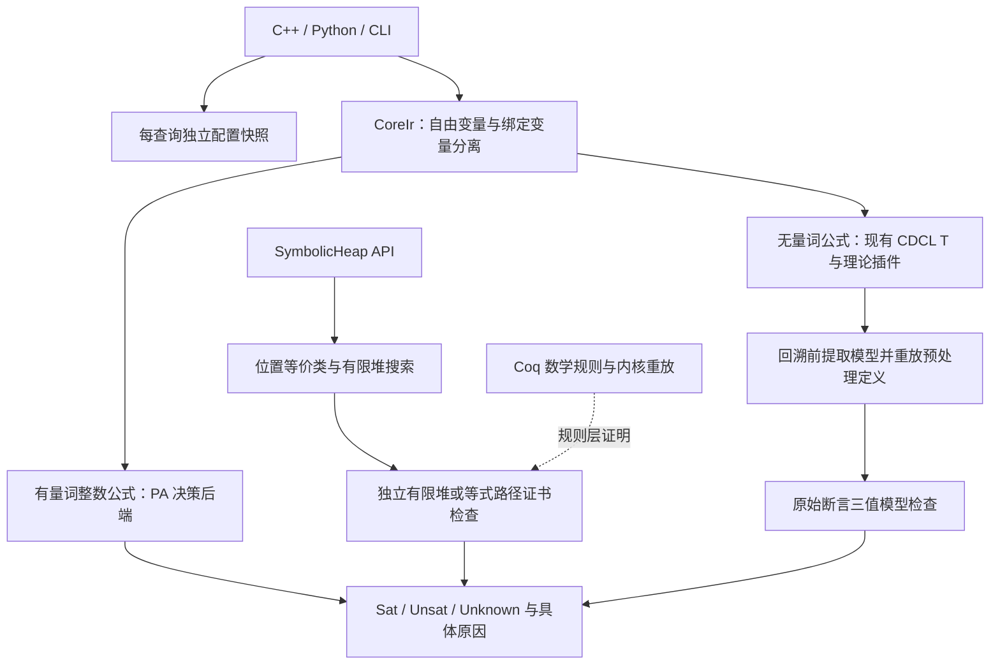

# PA、符号堆与查询配置：第二轮实现

这是第二轮的历史记录，下面的 CoreIr 图和旧目录路径描述当时的实现。
当前 CoreIR 已删除，公式直接使用 SOMTParser DAG；当前状态见
[NATIVE-TERMS.md](NATIVE-TERMS.md)，新增布尔／空间 SL 核心见
[SEPARATION-BOOLEAN.md](SEPARATION-BOOLEAN.md)。

本轮从第一轮的 11 个差分 unknown、406 项分散配置和证书检查内核继续实现。它新增实际决策过程，并修复模型提取时序。验证结果和二进制版本见 [VALIDATION-IMPLEMENTATION.md](VALIDATION-IMPLEMENTATION.md)；本文件描述功能契约，不能作为整个求解器已经形式化验证或没有其他 bug 的声明。

## 已落地的架构



搜索器、候选模型和证据检查已有独立模块。旧 CDCL(T) 路径仍有未要求正面证据的分支；`Result::Sat/Unsat` 不能统一理解为“原始查询已外部证明”。新增 SL 求解入口则在返回确定答案前强制调用独立检查器。

## 查询配置迁移

`env::Snapshot` 在公共 parse/checkSat 入口复制环境及实例覆盖值；`env::Scope` 用线程局部、可嵌套的作用域绑定该不可变快照。策略臂在自己的快照上补充默认值，用户显式设置优先。CLI 的默认参数和 timeout 也只写当前 Solver。

核心 `src/` 的原始 `getenv` 调用已收敛到 `EnvParam.cpp` 这一兼容边界；不再用 `setenv/unsetenv` 切换策略。迁移移除了 212 处函数静态参数缓存，另将三个全局缓存改为查询读取。参数观察登记只在要求 `XOLVER_DUMP_PARAMS` 时启用，避免每次普通参数读取都执行字符串格式化和全局 mutex。

```cpp
xolver::Solver solver;
solver.setRuntimeParameter("XOLVER_PA_WORK", "2000000");
solver.setRuntimeParameter("XOLVER_WALLCLOCK_MS", "5000");
solver.clearRuntimeParameter("XOLVER_PA_WORK");
```

Python 原始接口对应 `set_runtime_parameter` / `clear_runtime_parameter`。设置在当前实例 reset 后保留；不同实例和后续查询不会继承首个查询的静态参数值。

这是**配置读取与生命周期的统一迁移**。历史控制项仍保留各自语义，未被全部改造成类型化预算、能力枚举和诊断配置。清单见 [FLAGS.json](FLAGS.json)。修改环境变量的外部线程不在快照并发保证内；libpoly 信号处理、全局诊断状态等仍阻止承诺整个 Solver 可安全并发。

本轮额外删除 `XOLVER_AX_STORE_VS_BASE`：store 与其 base 的等价公理是无条件有效的理论规则，覆盖等式和二元 distinct。删除 `XOLVER_ANIA_PROFILE_TIMEOUT` 对嵌入进程的 SIGALRM / `_exit(0)` 终止行为；性能分析不能把未完成求解伪装为正常进程退出。

## PA 决策过程

实现位于 [`Presburger.cpp`](../../src/theory/arith/presburger/Presburger.cpp)。在任何 ground 预处理之前分流量词公式，使用独立的 `BoundVariable` 节点及 ExprId 绑定身份，避免按名字处理变量遮蔽。

当前决策语言：

- 无界整数、任意精度常数、加减和常数乘法、等式/不等式、distinct、布尔组合。
- 整数量词任意交替及自由整数/布尔变量的存在闭包。
- 非零常数除数的 Euclidean div/mod。商定义在其量词作用域内共享和消去，不越过全称量词。

算法先形成规范仿射约束、整除约束和析取范式，按 Cooper 型方法逐变量消去：统一系数并保留整除条件，枚举有限周期余类；有下界时使用下界邻域代表，无下界时使用向负无穷的周期代表。整数不等式按 gcd 向正确方向取整。规范子句去重、同方向约束保留最强界，并检测相反界冲突，减少重复展开。

这是一套可审计的 PA 核心决策实现，尚未证明该 C++ 实现的健全性与完备性。它不调用 Z3/cvc5 代求解；外部工具只用于差分测试。Cooper 算法参考可执行资料：[Harrison 的实现](https://www.cl.cam.ac.uk/~jrh13/atp/OCaml/cooper.ml)。整除语义依据 [SMT-LIB Ints](https://smt-lib.org/theories-Ints.shtml)。

默认工作预算 2,000,000、余类周期预算 100,000；`XOLVER_PA_WORK` / `XOLVER_PA_RESIDUES` 为 0 时取消相应预算，负数回到默认值。仍有递归深度限制及公共墙钟预算。耗尽返回 unknown。变量乘变量、非整数理论、除零、尚未支持的语法糖均明确返回 unknown。

例如以下输入由 PA 路径决定为 SAT：

```smt2
(set-logic LIA)
(assert
  (forall ((x Int))
    (exists ((y Int))
      (and (<= (* 2 y) x) (< x (+ (* 2 y) 2))))))
(check-sat)
```

当前返回决策结果，不重建量词策略或自由变量模型；请求不存在的模型会报错，不输出猜测值。UNSAT core 暂用完整原始前提，未实现最小化。PA 变换证书、投影接口、算术 ITE/abs 等语法扩展仍待实现；不能把它称作完整的程序验证服务。

## 分离逻辑的实际求解入口

[`SeparationLogic.h`](../../include/xolver/SeparationLogic.h) 提供 `sl::solve`、`sl::checkModel` 和 `sl::checkConflict`。实现位于 [`SymbolicHeap.cpp`](../../src/theory/separation/SymbolicHeap.cpp)。

当前片段是存在解释的 symbolic heap：位置等式/不等式的合取、`emp`、精确 points-to 单元、分离合取。位置 0 为 nil，禁止分配；位置域独立于整数，字段为位置或任意精度的具体整数字面量。

```cpp
#include <xolver/SeparationLogic.h>

xolver::sl::SymbolicHeap query;
query.pure.push_back({1, 2, false});
query.spatial.push_back({1, {
    xolver::sl::Field{xolver::sl::Location{2}},
    xolver::sl::Field{std::string("12345678901234567890")}
}});
auto answer = xolver::sl::solve(query);
// SAT 附有限堆模型；UNSAT 附引用原始等式前提的路径冲突证书。
```

搜索使用 union-find；UNSAT 检查器独立重放原始等式路径，验证具体的不等式冲突、nil 分配或两个 points-to 地址重叠。SAT 检查器验证纯约束、字段类型、非空、地址互异和精确 footprint，多余堆单元不能通过 `emp` 或单元堆检查。200 个小型随机查询另用有限位置赋值穷举对照；四个位置变量加 nil 最多需要五个位置，覆盖该组公式的全部相等模式。

完整 SL 不在此片段内：尚无 SMT-LIB `declare-heap` 前端、符号整数域与 PA 的组合、list segment/SID、空间否定、蕴含、frame inference、magic wand、权限及并发内存语义。C/C++ 的字节地址、分配块和悬空指针不能直接等同于当前抽象位置模型。

## 模型路径的修复

本轮针对旧差分样例修复：

- Purifier 的辅助名称使用 IR 的真正 fresh symbol，避免与用户 `bridge_0` 冲突；算术数据类型字段也建立共享桥接。
- 在断开 CaDiCaL 传播器前快照理论模型。断开可能触发回溯并清空 simplex 边界，之后再选取无穷小具体值会违反原始严格不等式。
- 在原始公式校验前恢复预处理消去的变量和严格界见证。
- 对数组数值索引的偶合做模型补全。EUF 类不同不代表它们一定要取不同数值；相同具体索引的读表需要一致解释。候选补全必须让**所有原始断言确定为真**才会被采用。
- 同输出的 UF 表可补成真正的常函数解释，支持相应的数组参数；未知布尔返回值不再误判为 false。无法具体解释的应用仍保留不确定性。
- 修复组合调度丢失 Full-effort 引理的问题：字段引理不能因为优先返回另一条共享等式而被丢弃。回归中的 `mk(2,2)=mk(1+k,k-3)` 要求同时满足 `k=1` 和 `k=5`，现在要求得到 UNSAT。
- 数据类型引理使用构造器等式本身作为稳定前提，跨回溯复用不再依赖某一次 trail 的解释。EUF 共享等式推迟到会交付引理的 Full-effort 路径；数值常量字段冲突带原始等式解释返回。
- 引理数据库存储完整规范子句，哈希只用来选择桶。数据类型注入性实例也使用完整三元组去重，避免仅凭哈希相同就漏掉不同义务；线性字段检查消除了最小 int64 取负和乘加溢出的未定义行为。
- LRA 对每条已决定的接口不等式都承担求解义务，移除“只有 arrangement 授权才能分支”的内部门控。变量与常量的比较把常量精确移到右端，不能因常量没有变量名而跳过；这修复了库 API 的 `uflra_012_unsat_fn_arg_pinned.smt2` 反例。

原 11 个样例均已加入回归；其中 10 个数组样例的模型可以正面检查，数据类型样例恢复了判定，但完整 DT 模型的独立导出检查仍是缺口。

## 形式化证明的准确边界

[`VerificationKernels.v`](../../proofs/VerificationKernels.v) 包含以下六条被显式检查依赖的定理：非负线性组合矛盾、整数除法取整、整除矛盾、等式路径检查器健全性、位置不等式冲突、nil 分配冲突。Coq 8.20.1 编译后再由 coqchk 重放；六条定理均报告不依赖额外公理。

这些证明针对数学规则和 Coq 路径检查函数。**没有证明 C++ 检查器与 Coq 定义逐步对应，也没有证明 PA 消量词、SMT-LIB 导入、预处理或整个 CDCL(T) 求解器。** 现有 DRAT/CNF 骨架的信任边界同样保留。

可复现入口是 `tools/remote/check_formal.sh`。服务器 Coq 依赖以独立目录中的系统包展开方式准备，不修改系统安装；记录版本、包哈希及工具哈希。OCaml 的单 domain 设置避免在 EOS 地址空间限制下预留默认 128 个 domain 的空间，依据 [OCaml runtime 文档](https://ocaml.org/manual/5.4/runtime.html)。

## 仍需继续处理的架构问题

- 给全部运行控制项定义稳定、类型化的归宿，统一 CLI 与库 profile，消除仍影响逻辑选择的“诊断”名义开关。
- 替换 libpoly backend 内仍存在的全局信号处理与 siglongjmp 恢复，采用明确的进程隔离或修复依赖。第一轮移除的只是外层 Solver 信号恢复，不代表库内此类路径已全部清除。
- 将 PA 等价变换、LIA 规则和跨理论 lemma 接入绑定原始前提的证据 DAG；逐步证明检查器实现的 refinement。
- 用独立语言语义配置接入数学程序、C/C++、Java 的 VC；位宽、溢出、堆布局、对象生命周期、异常及并发语义分别明确。

完整 benchmark、更多随机状态机、sanitizer 和长时间差分仍是后续验证工作；列出的通过结果不能替代未测试输入的正确性证明。
