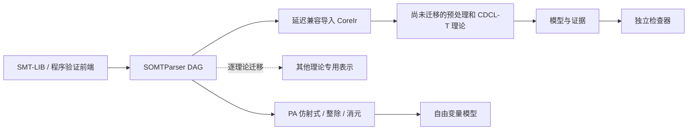

# 原生公式 DAG 与可执行的分层边界

> 历史阶段记录：以下 CoreIr 兼容层、408 项控制及迁移计划描述当时状态。
> 当前 CoreIR 已删除，见 [NATIVE-TERMS.md](NATIVE-TERMS.md)；当前登记控制为
> 404 项，见 [CONTROLS.md](CONTROLS.md)。控制项类型化不代表遗留 gate 清理完成。
> 整个 C++ 实现的形式化精化证明已按用户要求移出范围；求解器证书仍在范围内。

本轮接续 [第二轮实现](IMPLEMENTATION.md)，以用户提出的
“SOMTParser IR → 各理论自己的 IR”作为迁移方向。旧轮验证数字不代表本轮通过；
本轮服务器结果、源码及子模块补丁来源见 [验证记录](VALIDATION-ARCHITECTURE.md)。

## 公式表示的决定

SOMTParser DAG 是目标架构中唯一持久保存的通用公式表示。理论可以保存适合自身
算法的数据结构，例如 PA 的整数仿射式、整除原子及 DNF、SL 的符号堆、单纯形的
稀疏行、SAT 的布尔骨架。它们不再各自复制完整通用公式图。

本轮落地范围：

- 含量词的输入直接使用 `decision/pa/NativeInput` 读取原生 DAG，
  转入 PA 的专用表示。正常 parse/check/model 输出路径不创建 CoreIr。
- 原生读取器只保存节点句柄和身份索引。当前仍通过临时 `CoreExpr` 值复用读取词汇，
  不保存第二份表达式图；消除这一过渡词汇属于后续接口收敛。
- 旧 Term/Sort API、旧模型对象和旧 core 对象按需触发兼容导入。导入保留原始断言，
  同时恢复 sort/symbol 缓存；变更查询后使旧模型、core、证明失效。
- QF 理论仍使用 CoreIr。**本轮未完成全仓库 CoreIr 删除**，也未把原生入口用于所有逻辑。

在继续迁移前，必须加强 SOMTParser 的共享 IR 契约：绑定声明身份、作用域恢复、
节点可变性/缓存失效、来源和改写映射、管理器生命周期、增量撤销。复制一份
CoreIr 不会自动解决上游语义错误。本轮已修复同名量词绑定复用、内层退出后丢失
外层绑定，以及量词声明被结构合并的问题。

## 目录与链接边界

491 个源文件迁移到下列所有权层。每个原路径及迁移前 SHA256 保存在
[`architecture-migration.json`](architecture-migration.json)；服务器应用迁移前
核验旧文件并归档其内容，再移除对应旧路径。历史验证记录没有覆盖。

| 层 | 职责 |
|---|---|
| `base` | 精确数值、预算、查询配置输入 |
| `ir` | 过渡期的公式/句柄词汇、精确常量解码 |
| `contracts` | 模型、理论与 SAT 接口等数据/调用契约 |
| `algebra` | 多项式、区间、线性约束规范化 |
| `evidence` | 模型、冲突、证明检查与序列化 |
| `decision` | PA、有限符号堆等专用决策过程 |
| `frontend` | 解析适配、改写、预处理和模型重建 |
| `search` | SAT/CDCL(T)、理论协调及各搜索引擎 |
| `runtime` | 公共 API、查询生命周期、策略装配 |

`src/sources.cmake` 显式登记源文件，CMake 分别创建上述 object targets。
配置阶段执行 `tools/governance/architecture.py`，拒绝未登记源文件、逆向层依赖、
失效内部头文件，以及输入适配器外的直接环境读取。目录最大深度由原来的 5
降至 3（相对于 `src`）；深度统一是结果，职责和依赖边界才是依据。

实际解除的耦合包括：

1. 线性规范化只返回线性数据；SAT 原子登记移到 `search/linear`。
2. 依赖 SOMTParser passes 的重写适配器归入 `frontend/parser`，不再冒充基础 IR。
3. `TheoryModel` 从 `TheorySolver` 中独立，证据检查不再依赖求解器接口。
4. 符号堆检查与求解分开。`xolver_checkers` 可链接独立检查程序，不链接
   CaDiCaL、SOMTParser 或理论搜索实现。

这不意味着 `search` 内部已经完全解耦。NRA、NIA 和理论协调仍有大型实现文件和
内部循环关系，需要按状态所有权和算法职责继续拆分。

## 去重、正确性与模型

- 三个大预处理块从 `checkSatInternal` 提取为具名 pass；
  协调函数由约 3030 行降至约 2160 行，仍需进一步拆分。
- LIA/LRA/共享项/PA 复用精确数字解码，检查大整数、整数 sort、分母零和坏文本。
- NIA/NRA 复用线性边界镜像逻辑。
- 原生 DAG 和兼容 IR 共用一套特征检测规则与 JSON 输出，保留调优接口字段；读取原生特征不会触发 CoreIr 导入。
- 定义替换记录被消除变量，用于模型恢复；修复变量位于等式两侧时选错对象、
  多定义之间互相循环仍被删除、递归改写期间持有可失效节点引用的问题。
- PA 从自由变量消元记录反向恢复整数/布尔模型。线性上下界与整除周期确定
  候选，不以整数绝对值的有限搜索范围代替数学语义。发布前检查各投影约束。
  重建耗尽资源时保留 SAT 决策并明确模型不可用。

PA 模型重建不是量词消元正确性的独立证书。当前 `validateModel()` 不将量词公式
冒充为已由独立模型检查器证明；特别测试延迟导入后不能因原断言列表为空而误报通过。

## 运行控制的当前状态

新清单发现原统计漏掉的两个动态 EUF 控制，现有 **408 个名字、539 个读取位置**。
原 406 项清单保留为历史记录，新清单见 [CONTROLS.md](CONTROLS.md)。

所有生产代码读取点使用集中声明的编译期类型 key；区分 Presence、Flag、ExactZero、
Int、Long、Double，保留原语义差异，并使用每查询快照。仍有 **61 个控制保留 Text**
读取，它们包含路径、枚举、列表和历史自定义解析。声明可检查不等于这些控制已完成
领域语义整理，也不等于所有 gate 已删除。后续需要收敛为理论配置结构、删除失效分支，
将正确性前置条件从可选开关变成算法契约。

## 后续迁移顺序与验收

1. 先统一原生只读 term/source 接口、身份和生命周期；不再新增通用图复制层。
2. 迁移共享原子登记、布尔骨架、等式引擎，再逐一迁移线性算术、数组和数据类型。
   各理论只保存专用状态，并把模型/证据节点映射回原生输入。
3. 将旧预处理变成显式返回改写结果、模型恢复步骤和证明义务的 pass，
   最后移除 CoreIr 与兼容导入器。
4. PA 继续实现可独立重放的量词消元证书；SL 继续扩展前端、纯算术、归纳谓词、
   蕴含和相应证据。当前有限符号堆不能称为完整 SL。
5. 对检查算法建立精确 C++ 语义与证明模型之间的对应关系。已有 Coq 数学规则
   不能替代 C++ 端到端证明。

每批迁移需通过服务器单测/原始断言检查、双 oracle 差分、篡改拒绝和增量状态测试。
性能必须用冻结二进制和同输入对照衡量；本轮结构变化本身不构成显著提速证据。
