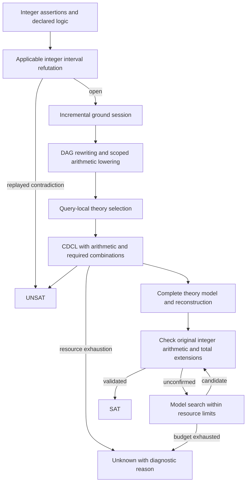

# SMT application

`Problem` contains native assertions, integer evidence requests and resource
limits. `Solver` selects a backend from syntax and sorts. `LogicSolver<L>` adds a
named signature check; per-logic `Solver.h` entries expose this same interface.
Theory combinations compose actual encodings rather than accepting a name as a
claim of complete coverage.

Ground integer reasoning shares a checked interval calculus with SV. Bounds on
variables and compound integer terms retain their original mandatory premises;
integer disequalities can exclude a zero endpoint. A refutation is accepted only
after certificate replay. Open interval proofs preserve the original query.

Integer div/mod use Euclidean semantics for nonzero divisors and explicit total
function interpretations at zero. Scoped nonzero facts eliminate unreachable
zero branches. Lowering exposes quotient/remainder bindings for constant
propagation; the remaining features select arithmetic or arithmetic/EUF stacks
for that query. The declared logic is retained across repeated checks.

Theory model reconstruction requests `getModelWithInternal()` so quotient,
remainder and combination witnesses remain available. The ordinary theory
`getModel()` interface retains its filtered view. Integer sort checks and the
zero-divisor interpretation tables are shared by native model validation and
the public `validateModel()` API.

The ordinary ground integer div/mod path is:

| Entry | Backend behavior |
| --- | --- |
| `qfbv`, `bv`, `qbf` | Modular circuits and BDDs; quantification in the BV/QBF entries |
| `qfufbv` | Ground UF applications with Bool/BV arguments/results and congruence constraints |
| `qfabv`, `qfaufbv` | Extensional finite arrays with Bool/BV indices and elements; UF composition where signatures match |
| `qffp`, `qfbvfp` | FP predicates/comparisons, value equality, abs/neg, BV reinterpretation and concrete four-operation arithmetic |
| `qfs`, `qfslia`, `strings` | Unicode constants, equalities, concrete string operations, regex membership and integer constraints |
| `qflira` | Mixed linear integer/real arithmetic through exact simplex and integer branch search |
| Arithmetic, `qfuf`, `qfax`, `qfdt`, `qfufdt` | Native quantified arithmetic or the attached incremental ground session |
| `fp`, `qfufbvfp`, `qfabvfp` | General entry contracts; unsupported binders/combinations return unknown |
| `sequences`, `sets`, `bags` | Entry contracts; the native operator backends are unavailable |

Finite arrays enumerate their index domain, so large domains can exhaust the
work budget. Arrays with infinite indices, nested arrays and nonfinite values
need another combination backend. Ground arithmetic arrays continue to use the
ground session. UF applications under binders do not use ground Ackermannization.

FP values distinguish signed zeros and use one semantic NaN. IEEE `fp.eq` and
SMT equality have distinct encodings. Addition, subtraction, multiplication and division use exact rational
rounding for concrete operands, including variables fixed by asserted equalities.
All five rounding modes are supported, and rounding-mode variables have an exact
five-value domain. Unconstrained symbolic FP arithmetic operands, FMA and square
root still require additional encodings. See the [SMT-LIB FP specification](https://smt-lib.org/theories-FloatingPoint.shtml).

String values use Unicode code points and SMT-LIB escaping. Pure string
equalities use a finite representative domain; other word constraints use
candidate search and exact evaluation. Failure to find a candidate does not
establish unsatisfiability over all strings. Regex membership supports literal,
range, union, intersection, difference, complement, concatenation, star, plus
and optional expressions. See [SMT-LIB Unicode strings](https://smt-lib.org/theories-UnicodeStrings.shtml).

Parsing for native theories uses `preserveNativeTheories` before constructing
assertions. `Solver::parseFile` configures this automatically. Direct native-node
clients must preserve FP/String/equality semantics in their input DAG; parsing
must not pre-evaluate these with host floating-point arithmetic or byte lengths.

Models include typed FP/String literals, finite array contents and UF tables.
Unsupported compound `get-value` requests produce an error rather than a guessed
value. FP/String/finite-combination encodings do not export independently
replayable UNSAT proofs.
