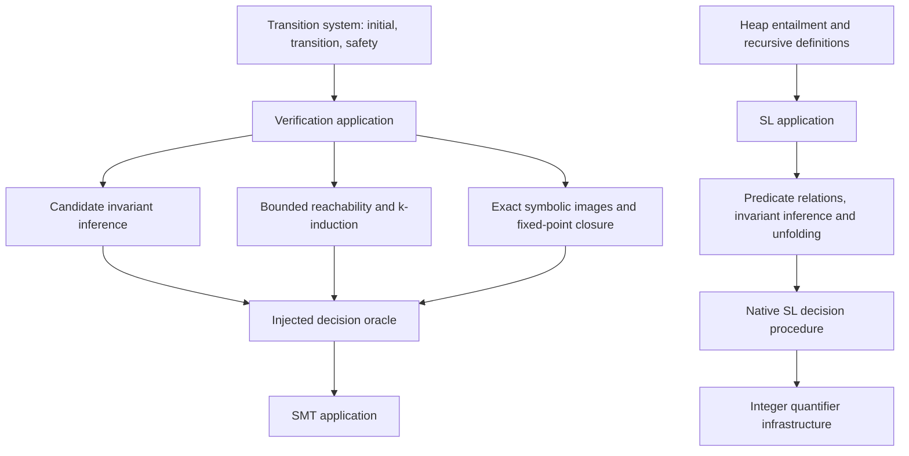

# Verification applications

SV composes explicit mathematical problems at the application layer. It accepts
native formulas and transition systems without requiring a programming-language
frontend. Clients choose integer/bit-vector arithmetic, state, inputs and heap
semantics; no C, Java or machine-overflow semantics are inferred.

| Application | Input | Result |
| --- | --- | --- |
| `pa` | Presburger formulas | Integer decisions, witnesses and elimination evidence |
| `sl` | Heap formulas and explicit least-fixed-point definitions | Decisions, structural predicate induction, entailments, counterheaps and checked invariants |
| `verification` | Verification conditions or a state transition system | Symbolic fixed points, reachable counterexamples, inductive invariants and safety certificates |

The verification application uses a `DecisionOracle`; it does not include the
SMT application. SL uses integer quantifier infrastructure for pure constraints
while preserving its explicit heap semantics. The PA application independently
uses that infrastructure; it does not dispatch arbitrary quantified formulas.
Helpers shared only by state verification stay in `verification`; SL-specific
inference stays in `sl`.

See [state verification](verification/README.md) and [heap reasoning](sl/README.md)
for contracts, algorithms and certificate limits. These APIs do not claim a
complete solver for arbitrary recursive heaps or infinite-state safety.
