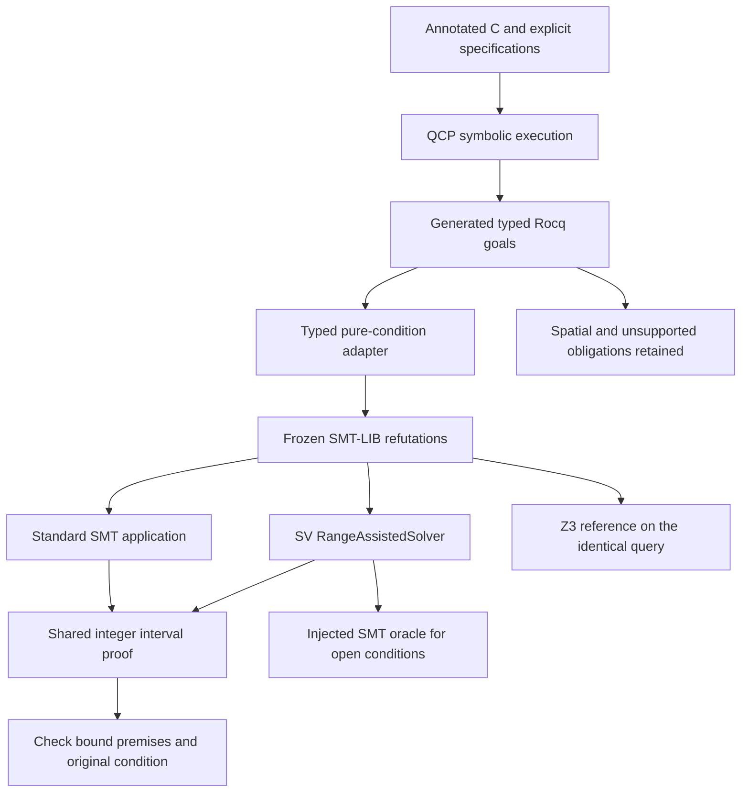

# QCP verification conditions

The QCP bridge reads generated Rocq conditions with explicit `Z` and `bool`
binders. It emits standard SMT-LIB refutations with source names, line numbers,
original-goal hashes and query hashes. The source adapter accepts its documented
first-order operators and rejects unknown binders/functions instead of assigning
them an integer sort. Spatial assumptions do not become arithmetic facts.
Rocq propositions and `bool` values remain distinct in the source type checker;
proposition equality is rejected rather than treated as Boolean equivalence.

`collect_qcp.py` invokes a supplied QCP checkout and writes generated files to a
separate results directory. It keeps QCP's command, source hash, exit status,
elapsed generation time and unsupported goals. A nonzero exit or generation
timeout is not a verified program. `reexport_qcp.py` reuses frozen Rocq goals
after verifying their hashes; it does not rerun the C frontend.



For a spatial entailment, only leading pure assertions on its right-hand side
are exported. Proving such a condition from the explicit pure hypotheses is a
sufficient pure subcondition. An unsupported hypothesis rejects that export;
it is not silently discarded. Residual heap obligations remain recorded.
A satisfiable pure refutation is a counterexample to this sufficient condition,
not necessarily to the heap entailment or C program. No result from this bridge
is counted as a complete QCP/Rocq proof or installed as an internal QCP callback.

Arithmetic has explicit contracts:

| Source | Meaning |
| --- | --- |
| `Z`, `INT_MIN`, `INT_MAX`, `INT64_MIN`, `INT64_MAX` | Mathematical integers and the bounds defined by QCP's `IntLib.v` |
| `÷`, `Z.quot` | Quotient toward zero; at a zero divisor the Rocq value is zero |
| `%`, `Z.rem` | Remainder with the dividend's sign; at a zero divisor the Rocq value is the dividend |
| `/`, `Z.div` | Quotient toward negative infinity, including negative divisors; zero divisor maps to zero |
| `Z.modulo` | Dividend minus divisor times the floor quotient |
| SMT `div`, `mod` inside exported formulas | Standard Euclidean SMT-LIB operations; their meaning is unchanged |

The remainder normal form preserves its sign explicitly and uses nonnegative
Euclidean remainder magnitude. Zero-divisor guards preserve Rocq totalization;
C division safety remains a separate QCP obligation. The semantic checks cover
positive, negative and zero operands independently of the interval proofs.

Example commands (run native solver work on the server):

```bash
python3 tools/integration/collect_qcp.py --qcp /path/to/QCP \
  --revision 08cc7a0f1373a1db3800111a0205a340b6d6f99c \
  --count 32 --output validation/qcp/corpus
python3 tools/integration/compare_qcp.py --corpus validation/qcp/corpus \
  --solver build/bin/xolver --sv build/bin/xolver-sv --z3 /path/to/z3 \
  --output validation/qcp/comparison
```

`xolver-sv` is a client of the public SV APIs. It parses the assertion snapshot;
the last assertion is the refutation condition, and preceding assertions are the
assumptions. It constructs the conclusion by negating that parsed condition, so
parser simplification cannot change the query's meaning. Its JSON output names
the proof method and whether a native interval certificate was replayed.
`RangeAssistedSolver` contains the orchestration; the CLI does not implement a
separate solver algorithm. The standard SMT application uses the same checked
integer refutation calculus for nonlinear integer queries before ground search.
An open interval proof delegates the unchanged query to ground search. Neither
application depends on the other, and interval reasoning never manufactures SAT.

The pinned, licensed QCP excerpts in `tests/integration/qcp` make a small CI
integration check reproducible without downloading QCP. Full corpus comparisons
are separate measurements. Reports count unknowns, timeouts, unsupported goals,
generation failures and disagreements separately; none is silently a success.
Reference availability is not a proof of source translation or C++ correctness.

QCP source: [QualifiedCProgramming](https://github.com/QinxiangCao/QualifiedCProgramming),
[QCP-V2.1.4](https://github.com/QinxiangCao/QualifiedCProgramming/releases/tag/QCP-V2.1.4).

`select_qcp_holdout.py` freezes programs from previously unused example
families, excluding development basenames and source hashes. The selection is
independent of solver outcomes. `analyze_qcp_corpus.py` counts generation failures
and unsupported definitions, excludes alpha-identical development queries, and
collapses alpha-identical repetitions before producing a benchmark manifest.
Alpha normalization preserves constants, sorts and assumptions; it does not
detect every semantically equivalent template. The first 24 novel queries in
seeded hash order receive three repetitions. The remaining queries receive one.
Use the [standard SMT comparison harness](../regression/README.md) for balanced
measurements. Report export coverage alongside solver coverage: deciding every
exported pure condition does not decide the unsupported spatial obligations.


`qcp_backend.py` provides an explicit discharge interface for **pending assigned
manual witnesses**. The QCP group owner supplies the original generated goal
file, its authorized manual copy, and exact witness names. Choose
`--backend xolver --binary /path/to/frozen/xolver` or
`--backend z3 --binary /path/to/frozen/z3`; use the same `--timeout 60` and
inputs for both. Execute through ExperimentOS on Panda1 with one physical CPU.
The adapter rejects an absent or mismatched lease, limits each invocation to
16 GiB, removes solver tuning controls, and records executable/input/output
hashes and every query result.

For example, within a proving group's assigned write boundary:

```bash
python3 tools/integration/qcp_backend.py --goals /path/to/case_goal.v \
  --manual /path/to/group/case_proof_manual.v --assigned exact_split_goal \
  --backend xolver --binary /path/to/frozen/xolver --timeout 60 \
  --output /path/to/group/backend-xolver
```

A supported goal produces a proof candidate only when every exported
sufficient condition returns UNSAT. The common reconstruction attempts prove
the original named Rocq statement, including its spatial conclusion. They
introduce no SMT axiom. The owner must incorporate/check candidates through
the canonical controller group-development and group acceptance commands;
parent verification and final-check remain required. An unsuccessful
reconstruction stays unproved. Already completed witnesses are excluded, and
SAT on a projection never labels the C program invalid.

This interface operates after QCP VC generation; QCP's opaque internal SMT
solver remains common to both backends. Reports explicitly distinguish external
backend invocations, unchecked proof candidates, kernel-checked VCs and verified
programs. The adapter alone reports zero verified VCs/programs. Full-program
comparison also needs the controller's final-check evidence and common manual
support for unsupported obligations.


The pinned QCP generator writes `Admitted` even to its auto-classified proof
module. Such a module is not an independently checked VC proof.
`prepare_qcp_controller.py --qcp /path/to/pinned/QCP --output /path/to/controller`
creates an isolated, source-hashed controller copy. It promotes each admitted
auto witness into manual obligations before publication and during final
independent replay. Native QCP and its original checkout stay unchanged.
Unsupported admitted syntax, duplicate witnesses, unchecked auto assumptions,
and completed auto proofs depending on moved admissions fail explicitly.
Invoke the copied controller with the original checkout as `--main-root`, using
the normal owner/acceptance workflow. Both compared backends must use the same
controller manifest. Never infer full verification from a controller run that
still imports admitted case witnesses.

Proof candidates follow `LLM_pre_process` with the common `lia`/`nia` closer.
The group owner must follow its plan and role policy; aggressive parents use
owner-controlled `Goal_apply` after their split proofs. A failed arithmetic
closer requires ordinary checked reconstruction facts, not an SMT axiom.

`audit_qcp_program.py` keeps program counts separate from raw query decisions.
Supply the canonical controller state, its successful leased `final-check`
record, the original goal, and both proof modules. Every required field in
`Module Type VC_Correct` must have a completed witness of the original type;
admitted case proofs are rejected even when the controller reports `done`.
Optional backend reports must share one frozen identity and the original goal
hash, cover every VC, and produce the exact candidate bodies present in the
checked module before the program is labeled backend-qualified. It reports
programs, VCs and external SMT queries separately. The stage evidence must
authenticate the supplied controller record; this ledger does not replace Rocq.
Missing backend reports leave external query counts unknown; they do not
establish that no solver calls occurred.
